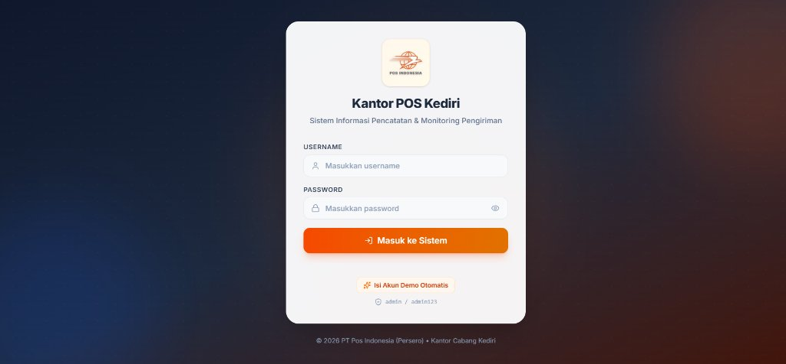
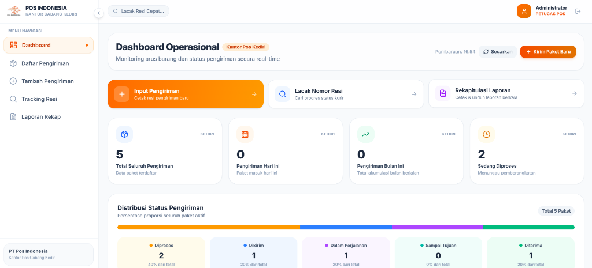
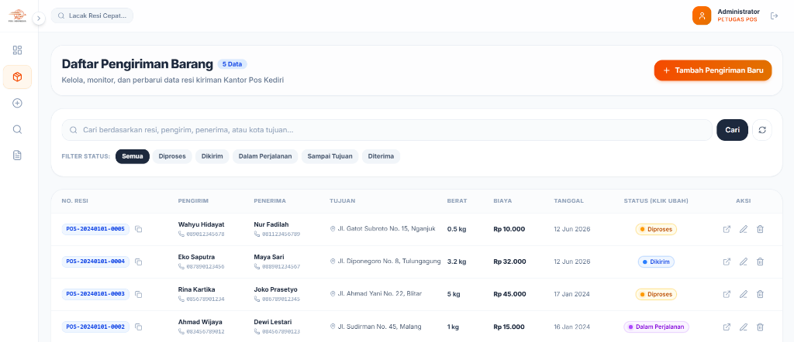
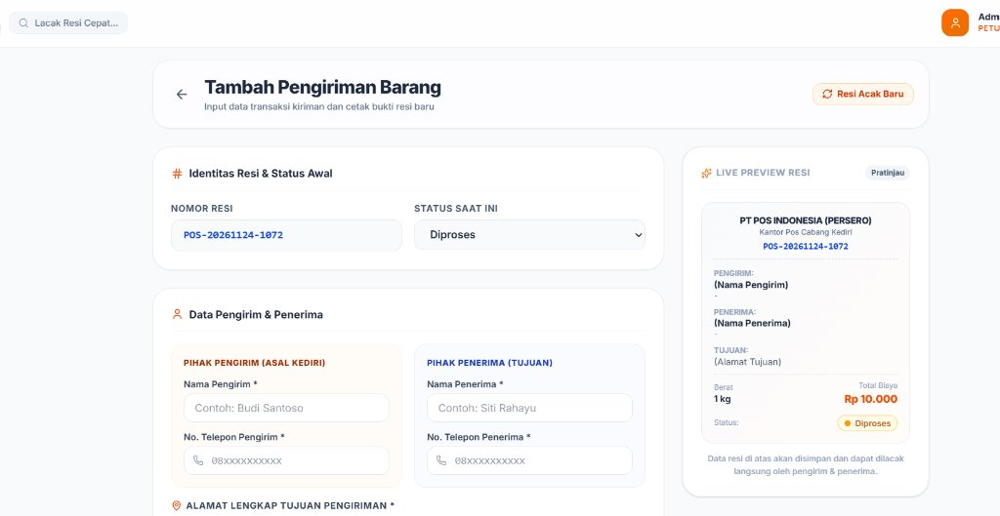
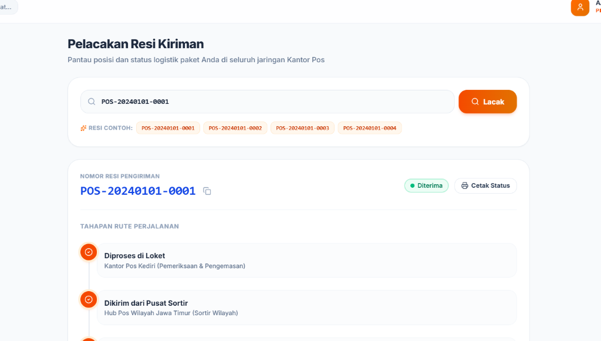
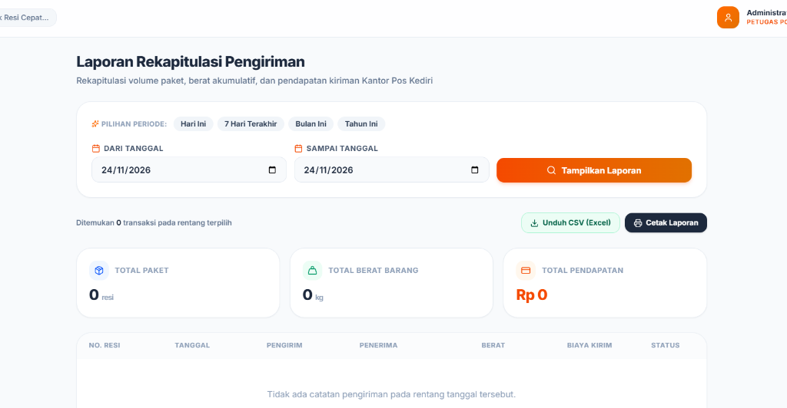

# 📮 Sistem Informasi Pengiriman Barang — Kantor Pos Kediri

<div align="center">


**Aplikasi web manajemen logistik, pencatatan transaksi kiriman paket, pelacakan resi real-time, dan rekapitulasi laporan operasional Kantor Pos Cabang Kediri (PT Pos Indonesia Persero).**

[Fitur Utama](#-fitur-utama) • [Tech Stack](#-tech-stack) • [Tangkapan Layar](#-tangkapan-layar) • [Panduan Instalasi](#-panduan-instalasi) • [Struktur Proyek](#-struktur-proyek)

</div>

---

## 📖 Tentang Aplikasi

**Sistem Informasi Pengiriman Barang Kantor Pos Kediri** dirancang khusus untuk memodernisasi alur operasional kurir dan staf loket pos. Aplikasi ini menyediakan alur kerja terpadu mulai dari pencatatan pengirim & penerima, kalkulasi ongkos kirim otomatis berdasarkan bobot paket, pemantauan status kiriman dalam 5 tahapan rute logistik, hingga penyusunan laporan rekapitulasi data dengan kemampuan ekspor dokumen CSV dan cetak resmi bertanda tangan.

Dibangun dengan arsitektur modern berprinsip **Clean Code & Separation of Concerns**, sistem ini menyajikan antarmuka yang cepat (*zero-render blocking*), responsif (*mobile & desktop friendly*), dan interaktif tanpa membebani performa browser.

---

## 📸 Tangkapan Layar Aplikasi

### 1. Halaman Autentikasi Masuk
Antarmuka login aman dengan fitur pengisian otomatis akun demo (*1-click demo filler*) dan opsi tampil/sembunyi password.



---

### 2. Dashboard Operasional
Pusat kendali operasional harian yang menyajikan ringkasan metrik paket, tombol pintasan kerja cepat, serta diagram visual distribusi status pengiriman aktif.



---

### 3. Manajemen Daftar Pengiriman
Tabel komprehensif data resi pengiriman dengan filter status cepat (*chips*), pencarian teks instan, 1-klik salin nomor resi (*copy to clipboard*), dan modal pembaruan status langsung.



---

### 4. Form Tambah Pengiriman & Live Receipt Preview
Formulir pencatatan paket baru dilengkapi fitur generate resi acak resmi, kalkulator tarif otomatis berdasarkan berat (kg), serta **Live Preview Resi** fisik yang terupdate secara *real-time*.



---

### 5. Pelacakan Nomor Resi (Tracking Stepper)
Alur pelacakan riwayat paket interaktif dengan stepper vertikal 5 tahapan rute logistik Pos Indonesia, badge posisi terkini, dan tombol pintasan nomor resi sampel.



---

### 6. Rekapitulasi Laporan & Ekspor Data
Fitur penyaringan laporan berdasarkan preset periode instan (*Hari Ini, 7 Hari Terakhir, Bulan Ini, Tahun Ini*), kartu ringkasan total biaya & bobot, ekspor ke format CSV (Excel), serta layout cetak (*print-ready*) lengkap dengan format tanda tangan kepala pos.



---

## ✨ Fitur Utama

- **🔐 Autentikasi Pengguna Aman**: Terintegrasi menggunakan NextAuth.js dengan hashing password `bcryptjs` dan proteksi rute dashboard berbasis sesi.
- **📊 Dashboard Interaktif**:
  - Metrik akumulasi: total kiriman, kiriman hari ini, kiriman bulan ini, dan paket sedang diproses.
  - Distribusi status pengiriman (*stacked progress bar*) proporsional dengan persentase otomatis.
  - Tombol pembaruan data (*manual refresh*) dengan indikator waktu pembaruan terakhir.
- **📦 Manajemen Pengiriman (CRUD Penuh)**:
  - Pencarian multi-parameter (nomor resi, pengirim, penerima, alamat tujuan).
  - Filter kategori status (*Diproses, Dikirim, Dalam Perjalanan, Sampai Tujuan, Diterima*).
  - Salin resi satu klik dengan notifikasi umpan balik Toast instan.
  - Ubah status kiriman langsung lewat modal interaktif tanpa berpindah halaman.
  - Paginasi data yang rapi dan terukur.
- **🧮 Kalkulator Tarif Ongkos Kirim Otomatis**: Menghitung estimasi biaya berdasarkan berat paket (standar tarif: Rp 10.000 untuk 1 kg pertama + Rp 8.000/kg berikutnya).
- **🧾 Live Receipt Preview**: Pratinjau nota fisik pengiriman secara langsung di sisi layar saat staf mengisi data formulir.
- **🚚 Pelacakan Multi-Rute Interaktif**:
  - Visualisasi 5 pos pemeriksaan: Loket Kediri $\rightarrow$ Sortir Hub Jatim $\rightarrow$ Armada Logistik $\rightarrow$ Cabang Tujuan $\rightarrow$ Diterima.
  - Chip nomor resi sampel untuk mencoba pelacakan instan tanpa mengetik manual.
  - Dukungan pelacakan via tautan langsung (`?resi=POS-xxxx`).
- **📑 Rekapitulasi Laporan Komprehensif**:
  - Tombol pintas pemilihan tanggal (*Hari Ini, 7 Hari Terakhir, Bulan Ini, Tahun Ini*).
  - Ekspor seluruh data tabel ke file `.csv` yang kompatibel dengan Microsoft Excel dan Google Sheets.
  - Format cetak dokumen standar (*print view*) yang secara otomatis menyembunyikan navigasi dan menampilkan kop resmi PT Pos Indonesia.
- **📱 Desain Responsif & Bersih**:
  - Sidebar desktop yang dapat diciutkan (*collapsible*) dan drawer menu untuk perangkat mobile.
  - Palet warna resmi Pos Indonesia (Signature Pos Orange `#F95700` & Deep Navy).
  - Sistem dialog konfirmasi saat hendak keluar akun (*logout*).

---

## 🛠️ Tech Stack

| Lapisan | Teknologi | Deskripsi |
| :--- | :--- | :--- |
| **Framework** | [Next.js 16](https://nextjs.org/) (App Router + Turbopack) | Server Component, Route Handlers, dan build pipeline cepat |
| **UI Library** | [React 19](https://react.dev/) | Library antarmuka berbasis komponen modern |
| **Bahasa** | [TypeScript 5](https://www.typescriptlang.org/) | Type-safety menyeluruh dari skema basis data hingga tampilan UI |
| **Styling** | [Tailwind CSS v4](https://tailwindcss.com/) | Utility-first CSS dengan variabel token warna dan animasi |
| **Icons** | [Lucide React](https://lucide.dev/) | Set ikon SVG bersih dan konsisten |
| **ORM** | [Prisma ORM 5](https://www.prisma.io/) | Type-safe Database Client & skema migrasi |
| **Database** | SQLite / PostgreSQL | SQLite (`dev.db`) untuk lokal, kompatibel PostgreSQL untuk produksi |
| **Autentikasi** | [NextAuth.js](https://next-auth.js.org/) | Autentikasi sesi berbasis JWT Credentials Provider |
| **Keamanan** | [bcryptjs](https://www.npmjs.com/package/bcryptjs) | Algoritma enkripsi salt hash satu arah untuk password |

---

## 🚀 Panduan Instalasi & Menjalankan Lokal

### Prasyarat
- [Node.js](https://nodejs.org/) versi `18.x` atau yang lebih baru.
- Manajer paket `npm` (disertakan bersama Node.js).

### Langkah-langkah

1. **Clone Repositori**:
   ```bash
   git clone https://github.com/username/sistem-pos-kediri.git
   cd sistem-pos-kediri
   ```

2. **Instal Dependensi**:
   ```bash
   npm install
   ```

3. **Konfigurasi Environment Variable**:
   Salin file konfigurasi contoh atau buat file `.env` di root direktori proyek:
   ```env
   # Basis data lokal SQLite (default)
   DATABASE_URL="file:./dev.db"

   # Kunci rahasia NextAuth
   NEXTAUTH_SECRET="pos-indonesia-kediri-secret-key-32-chars-auth-2026"
   NEXTAUTH_URL="http://localhost:3000"
   ```

4. **Inisialisasi Basis Data & Seed Data Contoh**:
   Jalankan migrasi skema dan masukkan data awal (akun admin dan 5 data resi contoh):
   ```bash
   npx prisma db push
   npm run seed
   ```

5. **Jalankan Server Pengembangan**:
   ```bash
   npm run dev
   ```

6. **Buka Aplikasi**:
   Akses [http://localhost:3000](http://localhost:3000) di browser Anda.

### Kredensial Masuk Bawaan
- **Username**: `admin`
- **Password**: `admin123`
*(Tersedia tombol **"Isi Akun Demo Otomatis"** di halaman login untuk pengujian cepat).*

---

## 📁 Struktur Proyek

```text
sistem-pos-kediri/
├── docs/
│   └── screenshots/          # Tangkapan layar untuk dokumentasi README
├── prisma/
│   ├── dev.db                # Basis data SQLite lokal
│   ├── schema.prisma         # Skema tabel User & Pengiriman
│   └── seed.ts               # Skrip data awal akun dan resi contoh
├── public/
│   ├── logo.png              # Aset logo resmi Pos Indonesia
│   └── favicon.ico
├── src/
│   ├── app/
│   │   ├── api/              # Route Handlers Next.js (REST API)
│   │   │   ├── auth/         # Endpoint autentikasi NextAuth
│   │   │   ├── dashboard/    # API kalkulasi metrik & statistik
│   │   │   ├── laporan/      # API filter rekapitulasi data laporan
│   │   │   ├── pengiriman/   # API CRUD data pengiriman
│   │   │   └── tracking/     # API pencarian pelacakan resi
│   │   ├── dashboard/        # Halaman-halaman portal dashboard
│   │   │   ├── laporan/      # Halaman rekapitulasi & cetak
│   │   │   ├── pengiriman/   # Halaman daftar & kelola resi
│   │   │   │   ├── [id]/edit # Form edit data pengiriman
│   │   │   │   └── tambah/   # Form tambah pengiriman & live preview
│   │   │   └── tracking/     # Halaman pelacakan alur paket
│   │   ├── login/            # Halaman masuk sistem
│   │   ├── globals.css       # Konfigurasi Tailwind v4 & utilitas cetak
│   │   ├── layout.tsx        # Root layout dengan font Inter Next.js
│   │   └── page.tsx          # Pengalihan rute awal (root redirect)
│   ├── components/           # Komponen UI modular
│   │   ├── AuthProvider.tsx  # NextAuth session context provider
│   │   ├── Navbar.tsx        # Header navigasi & profil staf
│   │   ├── Sidebar.tsx       # Menu samping responsif (collapsible)
│   │   ├── StatusBadge.tsx   # Badge status paket dengan live dot indicator
│   │   └── Toast.tsx         # Komponen pop-up notifikasi aksi pengguna
│   ├── lib/                  # Utilitas & konfigurasi client
│   │   ├── auth.ts           # Konfigurasi strategi NextAuth
│   │   ├── prisma.ts         # Singleton instance PrismaClient
│   │   └── utils.ts          # Helper formula tarif, format Rupiah & tanggal, CSV exporter
│   └── types/                # Definisi TypeScript interface & contract
│       └── index.ts
├── .env.example
├── .gitignore
├── package.json
└── tsconfig.json
```

---

## 📜 Skrip NPM

| Perintah | Deskripsi |
| :--- | :--- |
| `npm run dev` | Menjalankan Next.js development server pada port 3000 |
| `npm run build` | Melakukan generate Prisma client, sinkronisasi DB, dan kompilasi produksi |
| `npm run start` | Menjalankan hasil build produksi aplikasi |
| `npm run lint` | Melakukan audit kualitas kode dengan ESLint |
| `npm run seed` | Mengisi ulang akun admin default dan data paket sampel |

---

## 📄 Lisensi

Proyek ini dibuat untuk keperluan portofolio pengembangan web dan demonstrasi sistem informasi logistik.

---

<div align="center">
  <b>Kantor Pos Cabang Kota Kediri — 64100</b><br/>
  <i>PT Pos Indonesia (Persero)</i>
</div>
